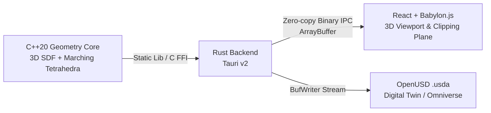

# Semi-Sim Studio

High-performance, cross-platform 3D semiconductor process simulator built with **Tauri v2**, **Rust**, **C++20**, and **Babylon.js**.

Simulates wafer etching and conformal deposition using a 3D Voxel Signed Distance Field (SDF) engine, extracts watertight multi-layer meshes via Marching Tetrahedra, streams geometry to the WebView over **Zero-copy Binary IPC**, and exports standard **OpenUSD (`.usda`)** assets for Digital Twin / Physical AI pipelines.

<!-- TODO: Replace with your app screenshot or GIF -->
<!--  -->

---

## Architecture



---

## Key Engineering Highlights

* **C++20 Volumetric Geometry Core (`cpp_core`)**
  * 3D Voxel SDF grid modeling Silicon Substrate etching (CSG subtraction) and conformal deposition (surface dilation with boundary clipping).
  * **Marching Tetrahedra** isosurface extraction with SDF gradient-based normal orientation for guaranteed watertight, manifold-friendly triangle meshes.
  * Dual-layer separation (`SiliconSubstrate` & `DepositionFilm`) with interface epsilon offset to prevent Z-fighting.
* **Safe Rust FFI & Zero-Copy Binary IPC (`src-tauri`)**
  * Automated C++20 static library compilation via `build.rs` + `cmake`.
  * Packs both mesh layers into a single contiguous byte buffer (`[8B Header | Substrate f32 | Film f32]`) transferred via `tauri::ipc::Response`, sliced directly on the frontend as `Float32Array` views without JSON serialization overhead.
* **Real-Time 3D Inspection (`src/`)**
  * Right-handed coordinate system alignment (`scene.useRightHandedSystem = true`) matching C++ geometry normals.
  * Interactive process sliders (Etch Depth, Deposition Thickness, Voxel Resolution), material layer toggles, wireframe inspection, and real-time Z-axis cross-section **Clipping Plane**.
* **OpenUSD (`.usda`) Asset Export**
  * Zero-dependency `.usda` scene graph writer outputting hierarchical `/WaferProcess/SiliconSubstrate` and `/WaferProcess/DepositionFilm` meshes with `primvars:displayColor`, ready for macOS Quick Look, Blender, or NVIDIA Omniverse.

---

## IPC Performance Benchmark (Binary vs. JSON)

Measured end-to-end (C++20 SDF + Marching Tetrahedra + Rust FFI + IPC + TypedArray view) at **48³ voxel resolution (~94k triangles)**:

| IPC Method | Serialization | Total Latency | Notes |
| :--- | :--- | :--- | :--- |
| **Binary IPC** (`tauri::ipc::Response`) | Raw `f32` byte buffer | **~10–20 ms** | Smooth real-time slider interaction |
| **JSON IPC** (`serde_json`) | UTF-8 JSON array | **~224 ms** | Noticeable UI/frame drop overhead |

> *Run the built-in `Run Benchmark (3x Avg)` tool in the app panel to measure exact numbers on your hardware.*

---

## Prerequisites & Quick Start

* **macOS / Linux / Windows** with C++20 compiler (`clang++` / `g++` / MSVC)
* [Node.js](https://nodejs.org/) (v20+), [Rust](https://www.rust-lang.org/) (1.85+), [CMake](https://cmake.org/) (3.20+)

```bash
# 1. Install frontend dependencies
npm install

# 2. Run in development mode (automatically builds C++20 core via CMake)
npm run tauri dev
```

---

## Project Structure

```text
semi-sim-studio/
├── cpp_core/                  # C++20 static library (CMake)
│   ├── include/semi_core/
│   │   ├── sdf_grid.hpp       # Multi-layer SDF wafer process modeling
│   │   └── marching_cubes.hpp # Marching Tetrahedra isosurface extractor
│   └── src/ffi_api.cpp        # C ABI boundary for Rust FFI
├── src-tauri/                 # Rust backend (Tauri v2)
│   ├── build.rs               # CMake integration & static linking
│   └── src/lib.rs             # Binary/JSON IPC commands & OpenUSD exporter
└── src/                       # React + TypeScript + Babylon.js frontend
    ├── App.tsx                # 3D viewport, HUD, controls & benchmark UI
    └── App.css
```
